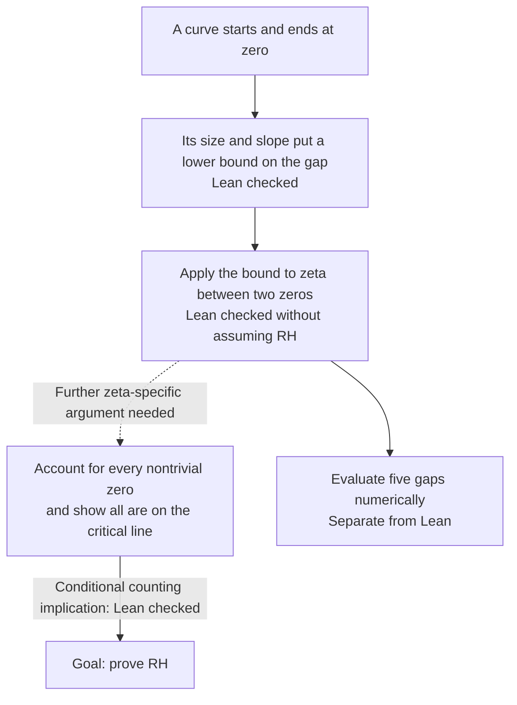

# Wirtinger and Riemann: following the gaps toward RH

**Proving the Riemann hypothesis remains our goal.** We have built the continuous zero-endpoint Wirtinger inequality and applied it to Riemann's zeta function in Lean. We have also proved a conditional counting step: if complete finite lists account for every nontrivial zero and their critical-line counts match their full counts at every stage, RH follows. Establishing those counts and completeness remains open.

There are **16 Lean checks** and, separately, **five numerical gap checks**. Supporting lemmas are included in the 16.

## What the 16 Lean checks establish

A curve that moves away from zero and returns to zero needs enough room or enough slope. For a continuously differentiable real or complex curve on `[a,b]`, with `a < b` and zero at both ends, Lean proves

$$\int_a^b |f(t)|^2\,dt \le \left(\frac{b-a}{\pi}\right)^2\int_a^b |f'(t)|^2\,dt.$$

Sine on `[0,pi]` attains the bound. For zeta, the curve is `f(t) = zeta(sigma + i*t)`, and its derivative is `i*zeta'(sigma + i*t)`. Lean derives that derivative and its continuity from Mathlib's analytic zeta function.

| Lean source | Named checks | Scope |
| --- | ---: | --- |
| [ContinuousWirtinger](../ContinuousWirtinger.lean) | 2 | Real zero-endpoint inequality and energy form |
| [ContinuousWirtingerComplex](../ContinuousWirtingerComplex.lean) | 3 | Complex inequality, squared gap bound and sine equality example |
| [RiemannZeroGaps](../RiemannZeroGaps.lean) | 9 | Zeta derivative, bounds on vertical lines and the critical line, and explicit implications involving RH |
| [RiemannHypothesisRoute](../RiemannHypothesisRoute.lean) | 2 | Conditional counting implication and equivalence for sound, complete finite lists |

The gap bound applies between zeros on a fixed vertical line `sigma != 1`, excluding the line through zeta's pole. The endpoints need not be consecutive. On the critical line `sigma = 1/2`, the bound requires no RH assumption. When the derivative integral is positive, it bounds the squared gap from below.

The same inequality also holds on other vertical lines. Using it to prove complete critical-line coverage needs a further argument about zeta; the dashed connection in the diagram has not been proved. The counting theorem spells out the requirement rather than supplying the missing zero counts.

## The five numerical gap checks

The [protocol](../research/riemann-wirtinger/local-check/gap-study-protocol.json) fixed the five pairs and criteria before calculation. Each pair was evaluated at 30 decimal digits with two integration subintervals and at 50 digits with four. Relative agreement had to be below `1e-18`; endpoint residuals had to be below `1e-25` and `1e-45`, respectively; the inequality slack had to stay positive.

| Zero pair | Computed gap | Computed lower bound |
| --- | ---: | ---: |
| 1–2 | 6.88731450 | 4.52374857 |
| 2–3 | 3.98881794 | 3.07066157 |
| 3–4 | 5.41401855 | 3.32991330 |
| 4–5 | 2.51018546 | 2.10426230 |
| 5–6 | 4.65111657 | 2.85695392 |

All five pairs passed these numerical criteria. The largest relative difference between evaluations was about `4.224e-30`. These calculations use zeta itself, including its complex phase. The approximate zeros and integrals are numerical results; Lean has not certified these numbers or a complete census of zeros.

[Results](../research/riemann-wirtinger/local-check/gap-study-results.json) · [CSV](../research/riemann-wirtinger/local-check/gap-study-results.csv) · [Script](../research/riemann-wirtinger/local-check/study_gaps.py).

## Verification

The [original local receipt](../research/riemann-wirtinger/local-check/verification.json), sources and logs are preserved together, with their original hashes. They record direct native Lean compilation and all 16 axiom reports. The root proof files are byte-for-byte copies of those checked sources. The new statements are also included in the repository's [full axiom audit](../CheckAxioms.lean), bringing its inventory from 1074 to 1090.

The [GitHub workflow](../.github/workflows/lean.yml) builds the combined library and checks every named axiom report. It saves a focused receipt for these 16 targets. A separate numerical job reruns the five-gap protocol in a temporary directory, checks agreement with the saved values and preserves its own output. The original numerical results are not overwritten. This evidence uses Lean's standard axioms `propext`, `Classical.choice` and `Quot.sound`; no additional axiom or proof placeholder was added.

Build the combined library with `lake exe cache get`, `lake build`, then `lake env lean CheckAxioms.lean`. To reproduce only the numerical study, copy its script and protocol to a working directory, install `mpmath==1.3.0` and run `python study_gaps.py` there. The [historical local package guide](../research/riemann-wirtinger/local-check/README.md) records how the first local checks were made.

## Existing work and attribution

The inequality is classical, and using it to study zeta-zero spacing is established work: [Hall's 2002 paper](https://eprints.whiterose.ac.uk/id/eprint/6750/) and [Bui and Milinovich, section 2](https://home.olemiss.edu/~mbmilino/LargeGaps.pdf). This addition formalizes the stated results and supplies the five numerical diagnostics; it does not claim a new inequality or an RH proof.

The [finite-ring proof](../Wirtinger.lean), [Ramanujan result](../RamanujanGap.lean) and all earlier published results remain unchanged. This continuous proof does not require a material path to close into a ring.

AI-generated by Codex; dictated and directed by NousVolition. Mathlib and the cited research retain their own authorship and licenses.
