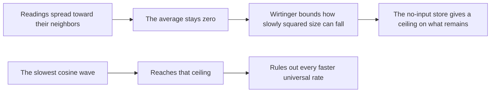

# Ring spreading fits the store bound

Put a set of readings around a ring and let each reading move toward its two neighbors. If their starting average is zero, how much of the original unevenness can remain?

**Lean proves a ceiling on what remains.** Add up the squares of the readings to measure their size. As the readings spread, that size stays at or below the amount held by `Gap.lean`'s store with no new input and the release rate below. A cosine wave reaches the ceiling: any faster rate would give a bound that this wave breaks at every positive time.



## What Lean checked

[`WirtingerStore.lean`](../WirtingerStore.lean) contains **19 checked statements**, including the supporting steps:

| Step | Checked result |
| --- | --- |
| Keep the average | The heat generator sums to zero, so spreading preserves the initial sum. |
| Follow the size | The derivative of squared size is minus twice the neighboring-difference cost. |
| Apply Wirtinger | That cost is at least the ring gap times squared size. |
| Connect to the store | A differential inequality bounds the size by the no-input `breathe` store. |
| Try to beat the bound | For at least three positions, the first cosine wave solves the heat equation, reaches the bound, and defeats every proposed faster rate. |

The main theorem assumes a nonempty finite ring, a differentiable path satisfying the coordinatewise heat equation at every real time, and an initial sum of zero. For every `t ≥ 0`, it proves

```text
size(f(t)) ≤ breathe r 0 (size(f(0))) t
           = size(f(0)) · exp(−r·t)

r = 2 · (2 − 2·cos(2π/n)).
```

Here `size` means the sum of squared readings, and `n` is the number of positions. The factor two comes from differentiating the squares. The main result is `ring_spreading_le_store`; `sharp_counterexample` bundles the heat equation, zero starting sum and the failure of every faster rate for `n ≥ 3`.

This is a general proof about the stated ring model. The [16 continuous-Wirtinger and Riemann checks and five numerical gap checks](riemann-wirtinger.md) remain separate results. This publication adds no fluid simulation or numerical zero measurements.

## Verification

The [original local receipt](../research/wirtinger-store/local-check/verification.json), [compiler axiom output](../research/wirtinger-store/local-check/axioms.log), [source snapshot](../research/wirtinger-store/local-check/WirtingerStore.lean) and [report](../research/wirtinger-store/local-check/report.txt) are preserved as the local check. Its historical wording describes the checkout at that time.

The [source input record](../research/wirtinger-store/source-inputs.json) links the original Windows file hashes to the published bytes, recording any CRLF-to-LF conversion per file. Every existing proof dependency matches the current repository; the new proof file is unchanged byte for byte.

The separate [Wirtinger store workflow](https://github.com/NousVolition/discrete-gap-inequalities-lean/actions/workflows/wirtinger-store.yml) recompiles the file and audits all 19 statements. Its `wirtinger-store-lean-evidence` artifact contains the compiler output and a receipt recording the exact commit, run, target list and hashes of the proof inputs. Existing `lakefile.toml`, `CheckAxioms.lean` and the earlier receipts are unchanged; this file is compiled explicitly by the new workflow.

Reproduce the focused check with:

```sh
lake exe cache get
lake build Wirtinger TwoWaveGapBridge Gap
lake env lean WirtingerStore.lean > wirtinger-store-axioms.txt
python3 .github/check_axioms.py WirtingerStore.lean wirtinger-store-axioms.txt
```

Lean: **4.34.0-rc2**, commit `6a10ac8c22beadecabdbb0919c2b50214762f91d`. Mathlib: `85e3a25e006c35636f0e53b0e9296caca2685bc0`. The 19 axiom reports contain only `propext`, `Classical.choice` and `Quot.sound`; there are no new axioms or admitted proofs.

## Credits

- **NousVolition:** original idea and words; dictation and direction.
- **Claude:** first connected the idea's shape and wording to a recognizable mathematical name; supplied the proof plan and sharpness test.
- **Codex:** generated the Lean implementation and carried out compilation and axiom checks.
