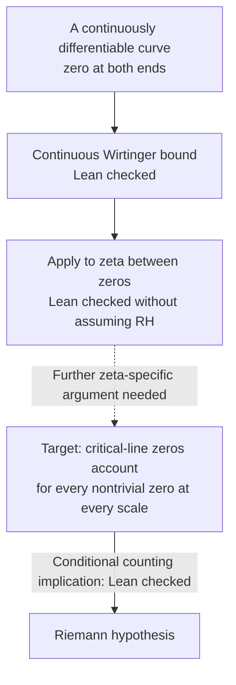

# Continuous Wirtinger within the Riemann-hypothesis investigation

The Riemann hypothesis remains the overall goal of this project. The first part is built: the continuous zero-endpoint Wirtinger inequality, its application to Riemann's zeta function, and an explicit counting condition that would finish the RH argument. **All 16 named declarations passed local Lean compilation and axiom auditing.** The needed complete zero counts have not been established, so RH remains open here.



## What was proved

For a real or complex curve `f` on `[a,b]`, with `a < b`, a continuous derivative and `f(a) = f(b) = 0`,

$$\int_a^b |f(t)|^2\,dt\;\le\;\left(\frac{b-a}{\pi}\right)^2\int_a^b |f'(t)|^2\,dt.$$

A curve that bulges away from zero and returns to zero needs either enough room or enough slope. The proof completes a square using a tangent whose poles are outside the interval, then takes a limit to obtain the pi-squared coefficient. Sine on `[0,pi]` reaches the bound with a positive integral.

The zeta application uses

$$f(t)=\zeta(\sigma+it),\qquad f'(t)=i\zeta'(\sigma+it).$$

Lean derives the derivative and its continuity from Mathlib's analytic zeta function. The bound holds between two zeros on any fixed vertical line `sigma != 1`; this exclusion avoids the line through zeta's pole. In particular, it applies to the critical line `sigma = 1/2` **without assuming RH**. The endpoints need not be consecutive zeros. If the derivative integral is positive, it also gives

$$\frac{\pi^2\int_a^b |f(t)|^2\,dt}{\int_a^b |f'(t)|^2\,dt}\;\le\;(b-a)^2.$$

| File | Checked content |
| --- | --- |
| [ContinuousWirtinger.lean](ContinuousWirtinger.lean) | Real zero-endpoint inequality and its energy form |
| [ContinuousWirtingerComplex.lean](ContinuousWirtingerComplex.lean) | Complex version, squared gap bound and sine equality example |
| [RiemannZeroGaps.lean](RiemannZeroGaps.lean) | Actual zeta function and derivative; vertical-line and critical-line bounds; explicit implications involving RH |
| [RiemannHypothesisRoute.lean](RiemannHypothesisRoute.lean) | RH follows from complete finite zero lists whose critical-line counts match the full counts at every stage; the converse holds for sound lists |

## What would finish the RH argument

The counting theorem requires a family of finite lists that eventually includes **every distinct nontrivial zero**, together with matching full and critical-line counts at every stage. It does not assume that this construction or these counts have already been obtained. Soundness means the lists contain only nontrivial zeros; completeness means no such zero is missed.

The spacing theorem also holds on vertical lines away from the critical line. This identifies the next mathematical requirement: a zeta-specific argument linking the available bounds to complete critical-line coverage. The dashed connection in the diagram is unproved. A finite collection of observed gaps cannot supply coverage at every scale. The proof files keep RH in the same investigation while making the direction of each implication explicit.

## First numerical use

The [protocol](gap-study-protocol.json) was written before computing the first five gaps, between zero indices 1 through 6. The same quantities were evaluated at 30 decimal digits with two integration subintervals and at 50 digits with four. The relative-agreement target was `1e-18`; endpoint residual limits were `1e-25` and `1e-45`. There was no parameter fitting.

| Zero pair | Computed gap | Computed Wirtinger lower bound |
| --- | ---: | ---: |
| 1–2 | 6.88731450 | 4.52374857 |
| 2–3 | 3.98881794 | 3.07066157 |
| 3–4 | 5.41401855 | 3.32991330 |
| 4–5 | 2.51018546 | 2.10426230 |
| 5–6 | 4.65111657 | 2.85695392 |

All three numerical criteria passed: precision agreement, endpoint residuals and positive inequality slack. The largest relative difference between the two evaluations was about `4.224e-30`. [Full results](gap-study-results.json) · [Table](gap-study-results.csv) · [Calculation](study_gaps.py).

These are numerical evaluations of the theorem's quantities. The approximate zeros and quadrature values are not certified by Lean, and agreement between two evaluations is not a rigorous error enclosure. The numerical study uses zeta itself, without removing its complex phase.

## Verification and reproduction

The [verification record](verification.json) binds the sources, compiled artifacts, 16 target names and axiom output. The five modules compiled with Lean `4.34.0-rc2`, using existing compiled Mathlib dependencies at `85e3a25e006c35636f0e53b0e9296caca2685bc0`. The Mathlib working tree was clean. The audit uses only `propext`, `Classical.choice` and `Quot.sound`; no new axiom, proof placeholder or native decision shortcut is used. This is a local native Lean check. It does not claim a GitHub run, Comparator check or nanoda check.

With Lean/Lake and the pinned dependencies available, the portable package configuration supports:

```sh
lake exe cache get
lake build
lake env lean CheckAxioms.lean
```

The recorded local run compiled the modules directly using [build.py](build.py), with explicit arguments identifying the installed Lean executable and the already compiled dependency directory. Those local installation paths are not embedded in this package. The Lake commands above are the reproduction route, not a claim that a separate Lake build was run here.

For the numerical diagnostic, install `mpmath==1.3.0` in the Python environment, then run:

```sh
python study_gaps.py
```

## Existing work and attribution

The continuous inequality is classical. Its use for zeta-zero spacing is an established approach: [Hall's 2002 paper](https://eprints.whiterose.ac.uk/id/eprint/6750/) and [Bui and Milinovich, section 2](https://home.olemiss.edu/~mbmilino/LargeGaps.pdf) give the context. This project supplies a local Lean implementation and a bounded numerical diagnostic; it makes no novelty claim for the inequality or the spacing method.

The existing [finite-ring proof](https://github.com/NousVolition/discrete-gap-inequalities-lean/blob/861fb2e42c155fe97e7bce9db7b3240adf9d5657/Wirtinger.lean) and [Ramanujan leftover result](https://github.com/NousVolition/discrete-gap-inequalities-lean/blob/861fb2e42c155fe97e7bce9db7b3240adf9d5657/RamanujanGap.lean) are unchanged. The continuous proof does not require a material path to close into a ring.

AI-generated by Codex; dictated and directed by NousVolition. Mathlib and the cited research retain their own authorship and licenses.
